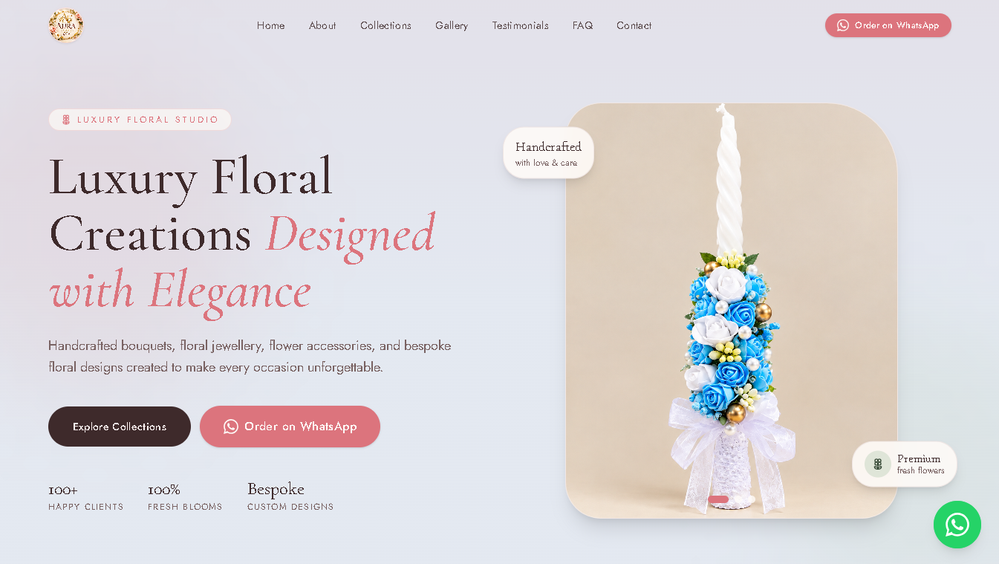
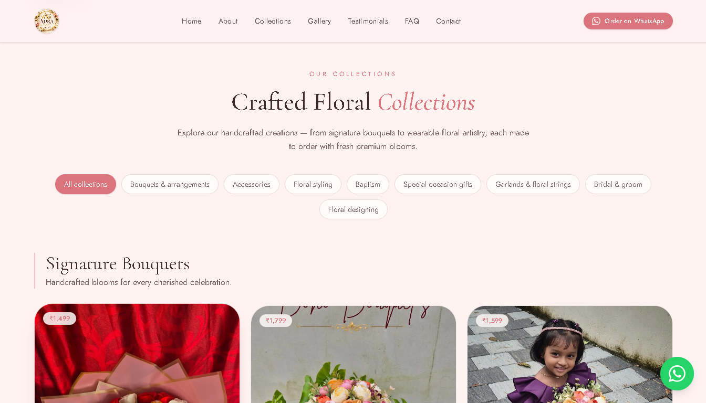
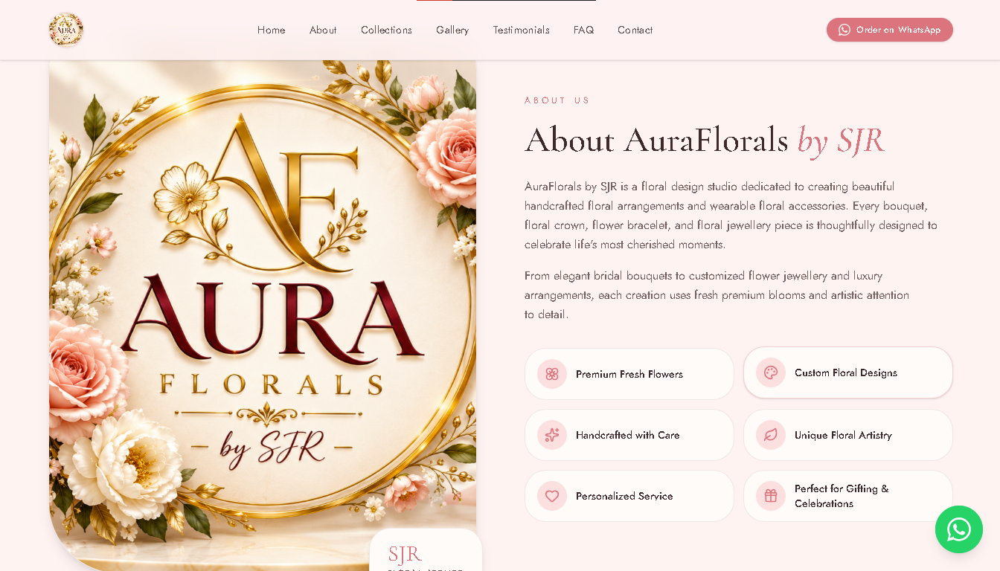
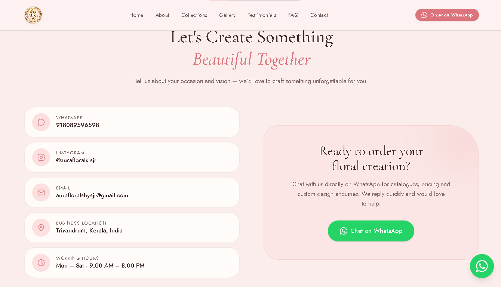
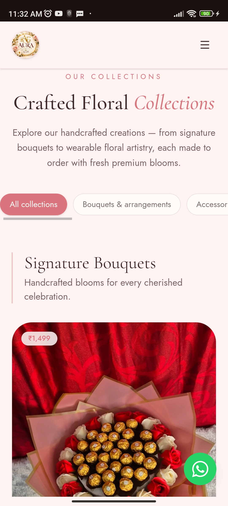
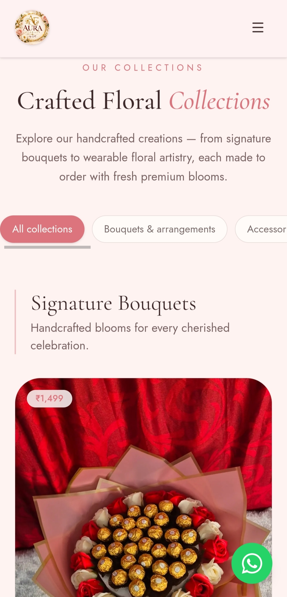

# Aura Florals by SJR

**A modern, responsive website designed and developed for a local florist business.**

---

## Table of Contents

- [Overview](#overview)
- [Key Features](#key-features)
- [Screenshots](#screenshots)
- [Tech Stack](#tech-stack)
- [Live Demo](#live-demo)
- [Developer](#developer)
- [License](#license)

## Overview

Aura Florals by SJR is a website built for a small florist business to establish its online presence, showcase its floral arrangements, and make it easy for customers to get in touch.

This repository is a project showcase. It contains documentation and screenshots only; the source code is kept private to respect the client's business.

### Objectives

- Provide the business with a professional and memorable online presence
- Present floral collections through a clean, visual-first layout
- Simplify customer enquiries and orders
- Deliver a fast, mobile-friendly experience

## Key Features

- **Elegant design:** a soft, refined look aligned with the brand identity
- **Fully responsive:** consistent experience across mobile, tablet and desktop
- **Gallery and product showcase:** bouquets and arrangements presented visually
- **Clear contact flow:** straightforward calls to action for customers
- **Optimized performance:** lightweight pages and compressed assets
- **Cloud deployment:** hosted on Render

## Screenshots

### Desktop

| Home | Collection |
|:---:|:---:|
|  |  |

| About | Contact |
|:---:|:---:|
|  |  |

### Mobile

  
  &nbsp;&nbsp;
  

## Tech Stack

**Languages**

**Tools and Platforms**

## Live Demo

**https://aura-florals-by-sjr.onrender.com**

The site is hosted on Render's free tier, so the first request after a period of inactivity may take 30 to 60 seconds to load.

## Developer

**Jithin Jeevan**
Full-stack developer, Thiruvananthapuram, Kerala, India

Interested in a website for your business? Get in touch through [LinkedIn](https://linkedin.com/in/jithnjvn).

## License

Copyright Aura Florals by SJR. All rights reserved.
Website design and development by [Jithin Jeevan](https://github.com/buildJOI).
